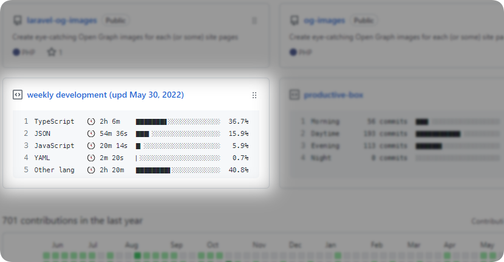

# WakaTime Statistics in your GitHub profile

Automatically update your pinned gist with weekly (monthly, yearly) WakaTime statistics.

<p style="text-align: center;" align="center">
<a href="https://github.com/abordage" title="WakaTime Statistics Gist">
    
</a>
</p>

<p style="text-align: center;" align="center">

<a href="https://github.com/abordage" title="language">
    
</a>

<a href="https://github.com/abordage/wakatime-box/blob/main/LICENSE.md" title="License">
    
</a>

</p>

## Features

- **Customizable time range**: Weekly, monthly, 6-month, yearly, or all-time statistics
- **One card per gist**: `models` for AI line changes, or `languages` for coding time
- **Customizable row count**: Display the top N rows on the selected card
- **Smart "Other" row**: Folds minor languages and non-code files on the languages card, and folds extra models on the models card
- **Two display formats**: Modern dotted format or classic bar chart
- **Self-hosted support**: Works with Wakapi and other WakaTime-compatible backends
- **Pinned Gist**: Perfect for your GitHub profile
- **Automatic updates**: Schedule daily runs with GitHub Actions

## How it works

1. [**Create**](https://wakatime.com/signup) WakaTime account (it's free)
2. **Enable** `Display code time publicly` and `Display languages, editors...` in
   WakaTime [profile settings](https://wakatime.com/settings/profile)
3. **Copy** a personal [OAuth token](https://wakatime.com/oauth). A WakaTime API key can only send
   plugin activity and cannot read stats. Wakapi still uses an API key in this same secret
4. [**Create**](https://github.com/settings/tokens/new) a token in your GitHub account settings with the `gist scope`
   only and **copy** it
5. [**Create**](https://gist.github.com) a new **public** Gist and copy ID from url (string after last slash)
6. **Fork** this repo
7. Go to **Settings** > **Secrets** > **Actions secrets** in **your fork**
8. **Create** new **Environment secrets:**
    - `GH_TOKEN`: GitHub token generated earlier
    - `WAKA_API_KEY`: OAuth token for WakaTime, or an API key for Wakapi
    - `GIST_ID`: your Gist ID

It's all. Go to **Actions** > **WakaTime Stats** and **Run workflow**. Gist should update and show your WakaTime stats.
Next, statistics will be updated automatically every day. Pin this gist on your profile!

## Usage in your workflow

```yaml
- name: WakaTime Box
  uses: abordage/wakatime-box@v4.0.0
  with:
    GH_TOKEN: ${{ secrets.GH_TOKEN }}
    GIST_ID: ${{ secrets.GIST_ID }}
    WAKA_API_KEY: ${{ secrets.WAKA_API_KEY }}
```

### With all options

```yaml
- name: WakaTime Box
  uses: abordage/wakatime-box@v4.0.0
  with:
    GH_TOKEN: ${{ secrets.GH_TOKEN }}
    GIST_ID: ${{ secrets.GIST_ID }}
    WAKA_API_KEY: ${{ secrets.WAKA_API_KEY }}
    DATE_RANGE: 'last_7_days'
    CARD: 'models'
    MAX_RESULT: '5'
    USE_OLD_FORMAT: 'false'
    PRINT_SUMMARY: 'true'
```

### Cards

`CARD` chooses the only card written into the gist. The default is `models`: AI models ranked by lines added or removed. A model row shows that model's share of AI line changes. `languages` shows coding time.

Upgrading from v3: a workflow that omits `CARD` now publishes the models card and renames the gist file. Set `CARD: languages` to keep the language card.

To show both cards on a profile, add a second public gist and a second step with its own `GIST_ID` and `CARD`.

```yaml
- name: WakaTime Languages
  uses: abordage/wakatime-box@v4.0.0
  with:
    GH_TOKEN: ${{ secrets.GH_TOKEN }}
    GIST_ID: ${{ secrets.LANGUAGES_GIST_ID }}
    WAKA_API_KEY: ${{ secrets.WAKA_API_KEY }}
    CARD: 'languages'
```

### With self-hosted backend (Wakapi)

```yaml
- name: WakaTime Box
  uses: abordage/wakatime-box@v4.0.0
  with:
    GH_TOKEN: ${{ secrets.GH_TOKEN }}
    GIST_ID: ${{ secrets.GIST_ID }}
    WAKA_API_KEY: ${{ secrets.WAKA_API_KEY }}
    WAKATIME_BASE_URL: 'https://wakapi.example.com/api'
```

### Inputs

| Input               | Description                                                                         | Required | Default                       |
|---------------------|-------------------------------------------------------------------------------------|----------|-------------------------------|
| `GH_TOKEN`          | GitHub token with gist scope                                                        | Yes      | -                             |
| `GIST_ID`           | ID of the Gist to update                                                            | Yes      | -                             |
| `WAKA_API_KEY`      | WakaTime OAuth token, or a Wakapi API key                                           | Yes      | -                             |
| `WAKATIME_BASE_URL` | Base URL for WakaTime API (for self-hosted like Wakapi)                             | No       | `https://wakatime.com/api/v1` |
| `DATE_RANGE`        | Time range: `last_7_days`, `last_30_days`, `last_6_months`, `last_year`, `all_time` | No       | `last_7_days`                 |
| `CARD`              | Card to publish: `models` or `languages`. One gist shows one card                   | No       | `models`                      |
| `MAX_RESULT`        | Maximum number of rows to display on the card                                       | No       | `5`                           |
| `USE_OLD_FORMAT`    | Use old format with bar chart                                                       | No       | `false`                       |
| `PRINT_SUMMARY`     | Print summary to GitHub Actions                                                     | No       | `true`                        |

## Feedback

If you have any feedback, comments or suggestions, please feel free to open an issue within this repository.

## Contributing

Please see [CONTRIBUTING](.github/CONTRIBUTING.md) for details.

## Credits

- Pavel Bychko ([abordage](https://github.com/abordage))
- [All Contributors](https://github.com/abordage/wakatime-box/graphs/contributors)

## License

The MIT License (MIT). Please see [License File](LICENSE.md) for more information.
